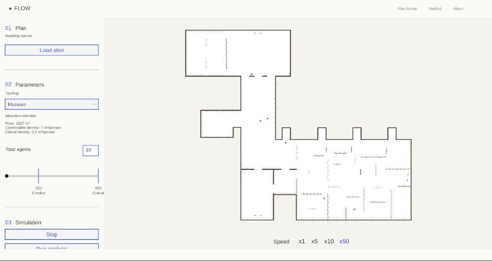
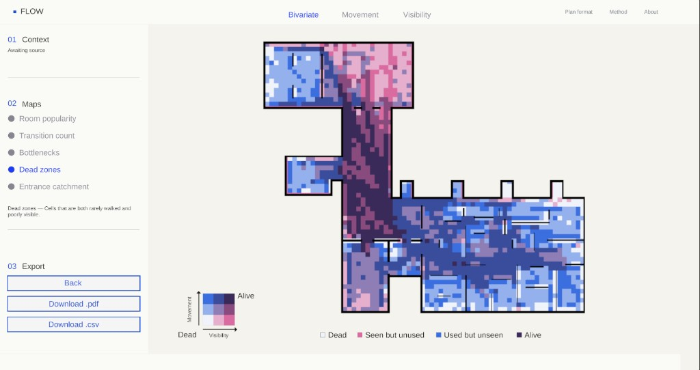

# FLOW

A web tool for **visitor-flow simulation** on a museum floor plan. Load a plan, run agents through it, then read spatial maps: where people walk, what they can see, which rooms are popular, and where dead zones appear.

Open the app: [malkovajuly97-source.github.io/flow](https://malkovajuly97-source.github.io/flow/)

## How it works

1. **Load plan** — import a `.gltf` / `.glb` floor.
2. **Parameters** — choose typology (`Museum`, attraction-oriented) and the number of agents. The slider is scaled from floor area: about **7 m²/person** (comfort) to **2.5 m²/person** (critical).
3. **Simulation** — agents walk between attractions. `MustSee` exhibits are preferred; speed drops gradually during the visit.
4. **Run analysis** — the recorded tracks become maps: room popularity, transitions, bottlenecks, dead zones (visibility × movement), entrance catchment.

The same instructions live in the top-right of the app: **Plan format**, **Method**, **About**.

## Plan format

One floor per file, exported as `.gltf` / `.glb`. Units in metres, Y-axis up. Geometry must be mesh-based, and **node names must match the layers exactly**.

| Layer | Role |
| --- | --- |
| `Floor` | Walkable surface |
| `Walls` | Physical barriers (also used for visibility) |
| `Entrance` | Agent start zone |
| `Exit` | Route end |
| `Attractions` | Regular points of interest |
| `MustSee` | Higher-priority exhibits |
| `Area` | Room zones for analysis |

Model `Floor` and `Walls` as separate solid volumes. Place `Area` as a plane just above the floor.

## Method

Calibrated on the **BIRD** dataset (Nancy Museum of Fine Arts: 51 visitors, 134 artworks, 2,221 tracks).

- **Route choice** — the next target is picked from nearby, mostly forward and visible candidates (in the source data ~89% were visible, ~67% ahead, ~93% among the five nearest forward options).
- **Profiles** — four visitor types: Active Explorer, Fast, Slow, Researcher.
- **Maps** — room popularity, transition count, bottlenecks, dead zones, entrance catchment. Dead zones are cells that are both rarely walked and poorly visible.

The model describes **recurrent patterns**, not individual people. Crowd avoidance is a calibrated heuristic.

## About

Behaviour-informed pedestrian simulation for museum spaces, built to support architectural and spatial decisions.

Author: **Iuliia Malkova**, IAAC, 2026.

Questions: [linkedin.com/in/yulia-malkova](https://www.linkedin.com/in/yulia-malkova/)
